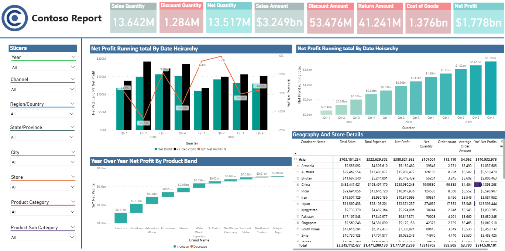

## 📊 Contoso Sales Report | Power BI Dashboard

**An Interactive Business Intelligence Dashboard for Sales & Profitability Analysis**

---

## 📌 Project Overview

The **Contoso Sales Report** is an interactive Power BI dashboard developed to analyze sales performance, profitability, product trends, and geographical business performance.

The dashboard consolidates key performance indicators (KPIs), time-based analysis, and detailed business metrics into a single reporting interface. Interactive slicers enable users to explore business performance across different years, sales channels, geographical locations, stores, and product categories.

**Project Objectives:**
- Monitor overall sales performance and profitability.
- Analyze Year-over-Year (YoY) changes in net profit.
- Evaluate cumulative profit using running total analysis.
- Compare product-level and geographical performance.
- Support data-driven decision-making through interactive reporting.

---

## 🖥️ Dashboard Preview

The dashboard combines KPI cards, quarterly profit analysis, running totals, product-level comparisons, geographical details, and interactive filters.

---

## 🎯 Business Objectives

- **Monitor Overall Sales Performance:** Track sales quantity, net quantity, sales amount, discounts, returns, cost of goods sold, and net profit through KPI cards.
- **Analyze Profitability Trends:** Examine quarterly net profit performance and understand how profitability changes over time.
- **Evaluate Year-over-Year (YoY) Performance:** Compare net profit percentages across reporting periods to identify changes in business performance.
- **Understand Cumulative Profit:** Use running total analysis to track the accumulation of net profit across the date hierarchy.
- **Compare Product Performance:** Examine YoY net profit across product bands to understand differences between product groups.
- **Explore Geographical Performance:** Analyze sales, expenses, net profit, order counts, and average order amount across geographical locations.

---

## 📈 Key Dashboard Components

### 1. Executive KPI Overview

The dashboard presents key business performance indicators (KPIs) in a consolidated view.

- **Sales Quantity:** Tracks the total quantity of products sold.
- **Net Quantity:** Displays net quantity after accounting for returns.
- **Sales Amount:** Measures overall sales revenue.
- **Discount Amount:** Tracks discounts applied to sales transactions.
- **Return Amount:** Monitors the value of returned products.
- **Cost of Goods Sold (COGS):** Represents the cost associated with sold products.
- **Net Profit:** Highlights profitability after accounting for relevant costs and adjustments.

These KPIs provide a quick overview of sales activity, revenue, discounts, returns, costs, and profitability.

### 2. Net Profit and Year-over-Year (YoY) Analysis

The quarterly performance visual combines net profit comparisons with a YoY net profit percentage line to analyze profitability trends over time.

**Key analysis areas include:**
- **Quarterly Comparison:** Compare net profit across different quarters.
- **Profitability Trends:** Observe changes in net profit over successive reporting periods.
- **YoY Performance:** Examine year-over-year net profit percentage movements.
- **Performance Monitoring:** Identify periods with changing profitability patterns.

### 3. Running Total Analysis

The cumulative net profit chart illustrates how net profit accumulates across successive quarters using running total analysis.

**This analysis helps users:**
- **Track Cumulative Profit:** Monitor the accumulation of net profit over time.
- **Analyze Growth Trends:** Understand how cumulative profit progresses across reporting periods.
- **Evaluate Overall Performance:** Assess accumulated results instead of viewing each quarter in isolation.

### 4. Year-over-Year Net Profit by Product Band

The waterfall-style visual compares YoY net profit across different product bands, highlighting variations in product-level profitability.

**Key analysis areas include:**
- **Product Comparison:** Compare YoY net profit across product bands.
- **Performance Differences:** Identify variations in profitability between product groups.
- **Profitability Trends:** Understand how product-level performance changes across the displayed categories.

### 5. Geographical and Store-Level Analysis

The detailed table provides a geographical breakdown of business performance, allowing users to compare key metrics across locations.

**Metrics analyzed include:**
- **Total Sales:** Compare sales performance across geographical locations.
- **Total Expenses:** Examine expenses associated with different locations.
- **Net Profit:** Evaluate profitability across geographical segments.
- **Net Quantity:** Review net product quantities across locations.
- **Order Count:** Compare order volumes between geographical areas.
- **Average Order Amount:** Analyze the average value of orders.
- **YoY Net Profit:** Examine year-over-year profitability performance.

This view supports geographical comparisons and helps users explore differences in sales, expenses, and profitability.

### 6. Interactive Slicers and Filtering

The dashboard includes interactive slicers that allow users to filter the report and explore specific business segments.

**Available filters include:**
- **Year:** Analyze performance across selected years.
- **Channel:** Compare performance across sales channels.
- **Region/Country:** Explore geographical performance by region or country.
- **State/Province:** Examine performance at the state or province level.
- **City:** Compare business metrics across cities.
- **Store:** Investigate store-level performance.
- **Product Category:** Analyze results by product category.
- **Product Subcategory:** Explore performance at a more detailed product level.

These interactive filters help users examine how business metrics change with different selections and support focused, data-driven analysis.

---

## 🛠️ Tools & Technologies

| Technology / Skill | Application in the Project |
|---|---|
| **Microsoft Power BI** | Interactive dashboard development and report design |
| **DAX (Data Analysis Expressions)** | Measures and calculations for sales and profitability analysis |
| **Time Intelligence** | Year-over-year performance analysis across reporting periods |
| **Running Total** | Cumulative net profit analysis across periods |
| **Data Modeling** | Organizing business data and relationships for reporting |
| **Data Visualization** | KPI cards, combo charts, waterfall-style visuals, and detailed tables |
| **Interactive Slicers** | Filtering data by year, channel, geography, store, and product category |

---

## 💡 Business Value

The dashboard brings key sales and profitability metrics together in a single interactive report, helping users gain meaningful business insights.

**Key benefits include:**
- **Performance Monitoring:** Track key indicators, including sales, discounts, returns, costs, and net profit.
- **Profitability Analysis:** Understand changes in profitability across reporting periods.
- **Product & Geographical Insights:** Compare performance across product bands and geographical locations.
- **Interactive Data Exploration:** Investigate business segments and analyze filtered results using slicers.
- **Data-Driven Decision-Making:** Present business information through structured visualizations and meaningful performance metrics.

---

## 📂 Repository Contents

| File | Description |
|---|---|
| `Contoso Sales Report.pbix` | Power BI report containing the interactive sales performance dashboard |
| `contoso-dashboard.png` | Dashboard screenshot for a quick visual preview |
| `README.md` | Project documentation, dashboard overview, features, and technical details |

### 📥 Download Power BI Dashboard

[⬇️ Download Contoso Sales Report (.pbix)](https://github.com/vansh02nagpal-ux/Contoso-Sales-Analysis/raw/refs/heads/main/Contoso%20Sales%20Report.pbix)

*Download the Power BI file and open it in Microsoft Power BI Desktop to explore the interactive report.*
---

## 👨‍💻 Author

**Vansh Nagpal**  
*Aspiring Data Analyst*

**Technical Skills:** Power BI · DAX · SQL · Microsoft Excel · Python · Data Visualization

**GitHub:** [View My GitHub Profile](https://github.com/vansh02nagpal-ux)

---

*This project demonstrates the practical application of Power BI, DAX measures, time intelligence, interactive reporting, and business performance analysis.*
